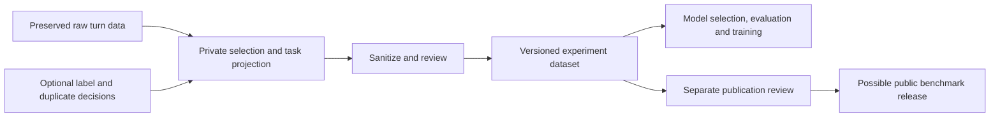

# Experiment dataset preparation design

**Privacy workflow accepted 2026-10-04; initial draft preparation implemented, broader design proposed.** This document owns the mechanisms supporting the [accepted requirements](specification.md#accepted-requirements). Source and consumer adapters are described in the [integration boundary](README.md#portability-and-source-integration); no repository-specific runtime is assumed.

The [Codex-only decision](technology.md) records the implemented private draft builder and controlled-edit boundary. Its current behavior refines the proposals below; live detection quality, persistent human review and final release packaging remain unverified or unimplemented.

## Data flow

All stages through experiment use remain local by default. Public release is a separate future action. No stage writes sanitized turns back to its source system, and existing experiments keep their pinned inputs and results.

## Preparation pipeline

The inspect/detect/transform/review/validate privacy workflow is accepted. The following full workflow remains a target except where implemented in the technology decision. Codex is selected for structured quote/occurrence findings, with standard-library span resolution, validation and controlled edits. The initial worker applies proposed replacements to a private draft; review and final public interfaces remain open.

1. **Pin and select.** Select immutable source artifacts and optional curation revisions, with explicit eligibility rules and complete selection counts. Read sources without changing them. Resolve selected context from those pinned inputs; reject ambiguous identities and unsupported source schemas. Record missing evidence instead of constructing a supposedly complete turn.
2. **Project for a task.** Declare which messages, context, annotations and targets each example needs. Preserve order, roles and boundaries. Allowlist output fields rather than copying arbitrary source dictionaries. Missing required context/targets blocks that example; optional absence gets an explicit reason. Excluded content remains available only in the private source.
3. **Sanitize all selected content.** Apply a versioned policy to inputs, context, targets, structured values and metadata. Use replacement, generalization, field removal or whole-example exclusion as appropriate. Record every transformation and its information loss privately. Never interpret an unsupported field, failed detector or skipped scan as a clean result.
4. **Review privacy and task meaning.** Review unresolved findings and inspect examples for contextual identification and confidential content. Separately assess whether transformed inputs still support the task and label/answer. A privacy decision does not verify a label; an existing verified label does not certify transformed text.
5. **Deduplicate and partition.** Group related sessions, branches, shared context and exact/near duplicates before assigning train/validation/test partitions. Check transformed content again for collisions introduced by masking. Save the grouping rule, split policy and assignments; unresolved overlap remains a reported limitation or blocks the affected evaluation.
6. **Seal and validate.** Produce a new immutable version with exact consumer input hashes, policy/code versions, counts, split membership and review evidence. Experiments pin this version and their rendering/tokenization recipe. Changed content, selection or policy creates a new version; no silent backfill of old datasets or results.

Task-dependent inputs, context and targets follow the [task profiles](specification.md#task-profiles).

## Sensitive content and transformations

Scope includes direct personal identifiers, indirect identifying combinations, credentials/secrets, and confidential content such as private code, customer information and internal project details. The exact taxonomy and project-specific rules remain to be agreed. Detection must cover assistant echoes and tool outputs as well as user prompts.

| Source surface / field path | Proposed transformation and output | Default, missing behavior and information loss |
| --- | --- | --- |
| Target and selected predecessor `messages[*].content`; task-specific tool arguments/results | Detect sensitive spans and context; replace consistent entities with typed placeholders such as `<PERSON_1>` or exclude content that cannot retain useful meaning safely. | All included text must be processed. Missing required text blocks the example; no fallback to raw text. Replacement loses original wording and can change task difficulty. |
| Nested strings, code, JSON keys, URLs, file paths and filenames within selected content | Inspect recursively using an explicit adapter; sanitize identifying path segments, hosts, query values, embedded secrets and confidential bodies. | Pattern matching alone is insufficient for contextual content. Uninterpretable included data requires review or exclusion. Preserve syntax when required by the task and verify it afterward. |
| Source session/turn IDs, source paths and source/input fingerprints | Retain only in a private lineage map; assign opaque release-scoped example/group IDs. Consumer hashes cover sanitized bytes only. | Never publish raw identifiers, raw-content hashes or reversible mappings by default. Cross-release identity links are not inferred from pseudonyms. |
| Source timestamps, machine/user/project metadata | Omit unless the profile needs an explicitly reviewed generalized value. Preserve message order separately. | Exact source times and rare metadata combinations can identify activity. Omitted values are unavailable, not zero. A retained duration must state its unit and that it measures the original execution. |
| Categories, reference answers, model explanations, human reasons and reviewer names | Include only required annotations; sanitize free text and keep reviewer identity/private evidence out of the consumer package. Reassess label/answer applicability after transformation. | Preserve original content origin privately. Carried labels remain unreviewed for the transformed example until reassessed; missing targets are not invented. |
| Images, audio, attachments, binary/encoded bodies and unknown record fields | Proposed first version supports declared text fields only; omit unsupported material with a reason or exclude the example if needed for the task. | No automatic clean status for nontext/unknown content. No attachment URLs or embedded payloads pass through implicitly. |
| Manifests, dataset cards, reports, logs and exported artifacts | Construct from an allowlist and inspect the complete output inventory, including names and free-text metadata. | Sanitized rows alone are insufficient. Private diagnostics, source snippets and lookup maps never enter the release by dependency traversal. |

Placeholder consistency must preserve references within each example and its context. The initial selected scope is the source session/context family, with repeated exact values linked consistently and ambiguous aliases reviewed. Persist the private mapping for a reproducible build, and create a fresh namespace for an independent release. Global identities and deterministic hashes of personal values are not proposed public pseudonyms. The [finding contract](technology.md#finding-and-edit-contract) defines the controlled-edit boundary.

**Synthetic example:** `Ask Morgan at morgan@example.org to inspect /Users/morgan/private-app/config.py` could become `Ask <PERSON_1> at <EMAIL_1> to inspect <HOME_1>/<PROJECT_1>/config.py`. The same references in an included assistant reply must use the same placeholders. This preserves the request's structure but loses identity and path specificity; the file content and surrounding context still need review. It is an illustration, not evidence of detection coverage.

Removing recognizable identifiers does not establish anonymity. Context, rare combinations and retained code may still identify people or projects. The release report must state what was checked and what remains uncertain; a zero-finding scan is not proof that all sensitive content is gone.

Source paths in the table describe logical surfaces, not a required raw file format. Each source adapter must map its exact fields to these surfaces and report unsupported content.

## Artifacts and row contract

Use an explicitly configured private data root outside source-code checkouts. The host integration chooses its storage layout; no AgentBoard database, archive implementation or machine path is required by this contract. Keep private build evidence separate from consumer and public packages:

| Artifact | Contents and access boundary |
| --- | --- |
| Private build evidence | Pinned source/curation references, recipe, source-to-example mapping, transformation/reviewer decisions, exclusions, detector results, code/environment and build outcome. Preserve originals through existing private dependencies. Avoid copying raw secret values into diagnostics; field locations and source references support review. |
| Sanitized consumer package | Allowlisted examples, task schemas, split assignments, sanitized annotations, policy summary, inventory/hashes and dataset card describing selection, intended uses, scoring, label origin, privacy review, utility loss and limitations. Consumers can load and evaluate it without reading private archives or mappings. |
| Future public release | A separately reviewed copy of an exact consumer package with publication evidence. No raw dependency closure, private build receipt or unresolved reference is bundled automatically. |

Proposed logical fields below are not an implemented JSON schema. JSONL plus a JSON manifest is an initial format proposal; task adapters can later produce other training formats.

| Field | Meaning and missing-data rule |
| --- | --- |
| `schema_version`, `dataset_version`, `task_profile` | Required immutable version/profile references. Unknown versions fail validation. |
| `example_id`, `group_id`, `split` | Opaque dataset-scoped identities and a saved partition. Unassigned examples cannot enter training/evaluation exports requiring a split. |
| `input.messages`, `input.context`, `context_status` | Ordered sanitized role/content with explicit context availability/exclusion. Only roles supported by the chosen profile are allowed. |
| `target`, `target_status` | Profile-specific sanitized category/response/reference; null with a reason if unavailable. Eligibility rules decide whether such examples are usable. |
| `annotation_origin`, `annotation_review` | Content origin following the [origin vocabulary](specification.md#terminology-and-conventions), separate from human review and applicability to this sanitized version. Privacy review is another independent state. |
| `input_sha256`, `example_sha256` | Calculated hashes of exact sanitized consumer input bytes and the example excluding its own `example_sha256` field, under a pinned serialization. Raw classifier-input hashes stay private. Serialization/encoding rules must be finalized before implementation. |
| Manifest policy, inventory and counts | Pin transformation policy, build/code versions, artifact hashes and declared task/split rules. Account for selected, emitted, excluded and blocked examples; categories must reconcile without silently dropping failures. Public aggregates must also pass privacy review. |

A private receipt links the sanitized package hash to its raw dependencies. The public package's reproducibility claim covers loading, task rendering and evaluation on the released data; reproducing raw-to-sanitized preparation requires private access. An integration must preserve its private archive dependency guarantees rather than hide missing raw dependencies. A release-packaging interface needs a separate design before export implementation.

See the [acceptance checks](specification.md#proposed-acceptance-checks) for verification and the [roadmap](roadmap.md) for unresolved policy and implementation choices.
