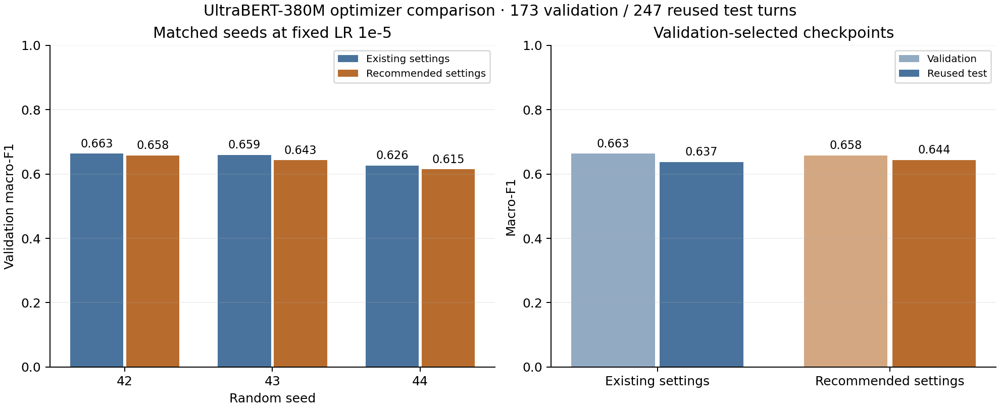
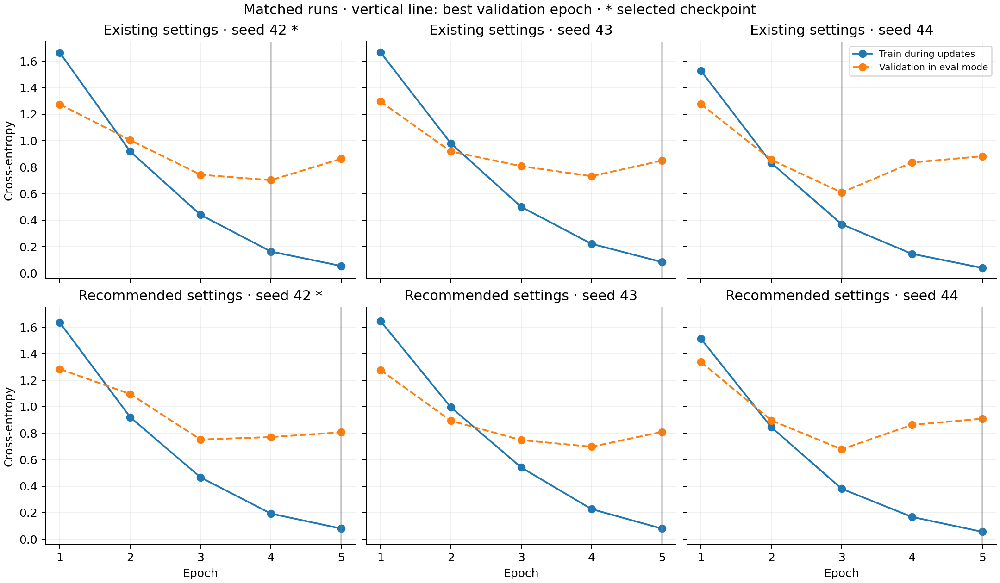

# UltraBERT turn classification

**Completed 15 October 2026.** UltraBERT-150M and UltraBERT-380M were fine-tuned on the frozen [ModernBERT cohort](turn-classifier-comparison.md#what-the-experiment-held-constant). A separate 380M round tested DMIS's recommended optimizer at the existing winning learning rate. The small test gain from that optimizer is inconclusive, while validation macro-F1 declined for every matched seed.

This is agreement with saved independent Astra xhigh labels, not human-verified accuracy. The holdouts had already been inspected; these are retrospective comparisons. [Aggregate measurements](measurements/2026-10-15-ultrabert.json) contain numeric results only. Private sources, per-turn predictions, manifests, checkpoints and complete histories remain in local experiment storage.

## Matched cohort and selection

All models use 1,011 training, 173 validation and 247 test turns in chronological whole-session/fork groups. Related groups stay together; this does not guarantee disjoint timestamp windows. Inputs put the target turn before its immediate predecessor, use the same markers, and right-truncate at 8,192 tokens. All eight categories contribute to macro-F1, including zero-F1 categories. Creative-media has four training examples and one in each holdout.

UltraBERT uses a different tokenizer from ModernBERT. Membership, labels and full serialized text match; retained token IDs differ between tokenizer families. UltraBERT's single-sequence layout has a BOS prefix; ModernBERT uses CLS/SEP boundaries. The two UltraBERT sizes have identical tokenizer files and retained tokens. Seven UltraBERT training inputs truncate; none in validation or test do. Three empty training targets remain included.

The initial runs preserve the ModernBERT optimization recipe: effective batch 16, unweighted cross-entropy, AdamW, linear schedule, clipping at 1.0, five-epoch maximum and patience two. Learning rates 2e-5, 1e-5 and 5e-5 use seed 42; the winning rate repeats with seeds 43 and 44. Highest validation macro-F1 selects the checkpoint, with lower validation cross-entropy breaking ties. Selection and its checksum are saved before test evaluation.

| Selected checkpoint | Validation F1 | Reused test F1 | Test agreement |
| --- | ---: | ---: | ---: |
| ModernBERT Base | 0.5472 | 0.4978 | 61.54% |
| ModernBERT Large | 0.5950 | 0.6369 | 75.71% |
| UltraBERT-150M | 0.6760 | 0.6111 | 73.28% |
| UltraBERT-380M, original optimizer | 0.6631 | 0.6369 | 75.71% |
| UltraBERT-380M, recommended optimizer | 0.6575 | 0.6439 | 77.33% |

UltraBERT-150M selected LR 2e-5 / seed 44 / epoch 4. The original 380M selected LR 1e-5 / seed 42 / epoch 4. Descriptive paired group-bootstrap test F1 intervals for original 380M minus 150M and ModernBERT Large are [-0.0343, +0.0661] and [-0.0608, +0.0820]; neither establishes an advantage. Different tokenizers, Transformers versions and execution profiles prevent an architecture-only comparison.

## Recorded training time

**Reviewed 16 October 2026 from preserved run manifests and histories; no retraining.** The 23 full candidate runs total **267.23 minutes (4 h 27 min 14 s)**. All use 1,011 training and 173 validation turns. The [aggregate measurements](measurements/2026-10-15-ultrabert.json) retain each run's `training_seconds`, the selected run and summed durations.

| Model / optimizer | Full runs | Completed epochs | Selected run, minutes | All runs, minutes |
| --- | ---: | ---: | ---: | ---: |
| ModernBERT Base | 5 | 24 | 11.37 | 54.46 |
| ModernBERT Large | 5 | 25 | 6.77 | 33.95 |
| UltraBERT-150M | 5 | 24 | 12.05 | 58.47 |
| UltraBERT-380M, original | 5 | 25 | 15.20 | 75.09 |
| UltraBERT-380M, recommended | 3 | 15 | 15.09 | 45.27 |
| Total | 23 | 113 | — | 267.23 |

Each saved model manifest's `training_seconds` measures elapsed wall time from immediately before the first epoch through the last completed epoch, including validation, progress/history writes and best-checkpoint writes. Sum the unrounded seconds once per full run, then divide by 60; for example, the original 380M's five runs total 4,505.2212 seconds / 60 = 75.0870 minutes. Displayed rows are rounded independently. Smoke checks, speed profiles, downloads, data preparation, initial loading/optimizer setup, final test evaluation, fixed-checkpoint diagnostics, artifact hashing/sealing, archiving and idle time are excluded. The total is accumulated run time, not end-to-end project elapsed time or measured GPU-kernel time.

Selected-run duration covers that candidate's entire training run, including epochs after the retained best epoch. For example, original 380M selected epoch 4 but completed five epochs; 15.20 minutes covers all five. Base and 150M each have one four-epoch early stop; the other runs completed five epochs.

ModernBERT Base used SDPA, gradient checkpointing and microbatch 2; Large and UltraBERT used FlashAttention 2 without gradient checkpointing and had different physical batch limits. These timings compare the recorded configurations, not model architecture alone; see [ModernBERT compute trade-offs](turn-classifier-comparison.md#compute-trade-offs-and-class-coverage) and the [UltraBERT runtime](#portable-workflow). Luna low/max runs used prompted inference without task-specific training, so their inference durations are outside this training total.

## Original 380M runs

All five completed five epochs. Best epoch identifies the retained checkpoint, not the final training epoch.

| LR | Seed | Best epoch | Validation F1 |
| --- | ---: | ---: | ---: |
| 2e-5 | 42 | 5 | 0.6487 |
| 1e-5 | 42 | 4 | 0.6631 |
| 5e-5 | 42 | 5 | 0.6350 |
| 1e-5 | 43 | 5 | 0.6589 |
| 1e-5 | 44 | 3 | 0.6264 |

## Recommended optimizer at fixed LR

The [pinned DMIS model card](https://huggingface.co/dmis-lab/UltraBERT-380M/blob/7789071ca161cb99e03ec1006655d24ad8c1b0e1/README.md#fine-tuning) supplies the alternative settings. This round changes the four settings below together; it cannot attribute the effect to an individual setting. Peak LR stays **1e-5** for smoke and all three full runs. No new LR was tested. Seeds, data, inputs, five-epoch limit and execution profile stay fixed.

| Setting | Original | Recommended |
| --- | ---: | ---: |
| AdamW β1 | 0.9 | 0.9 |
| AdamW β2 | 0.999 | 0.98 |
| AdamW ε | 1e-8 | 1e-6 |
| Weight decay | 0.01 | 0.1 |
| Warmup | 10% / 32 updates | 5% / 16 updates |
| Schedule | Linear | Linear |

| Seed | Original best epoch / F1 | Recommended best epoch / F1 |
| --- | ---: | ---: |
| 42 | 4 / 0.6631 | 5 / 0.6575 |
| 43 | 5 / 0.6589 | 5 / 0.6430 |
| 44 | 3 / 0.6264 | 5 / 0.6147 |
| Three-seed mean ± sample SD | 0.6494 ± 0.0201 | 0.6384 ± 0.0217 |



The recommended optimizer selects seed 42 / epoch 5. Test macro-F1 rises by 0.0070 and agreement by four turns, from 187/247 to 191/247. The paired whole-group bootstrap 95% F1-difference interval is **[-0.0392, +0.0439]**, using 1,000 resamples and seed 42. It includes both gains and losses and does not correct reused holdouts, selection or label errors. Validation is lower for all three seeds; this round does not establish a reliable improvement.



Training took 45.27 minutes for the three new runs, excluding initial loads, smoke and final evaluation. All three complete five epochs. The original settings, all five original runs and checkpoints remain separate; 158 original files were verified unchanged. All 146 new artifact hashes were independently checked after completion.

## Portable workflow

The committed scripts generalize the preserved experiment snapshots; the historical results above were produced by those snapshots, not by rerunning training after this PR refactor. Existing ModernBERT defaults remain unchanged.

[download_ultrabert.py](../cronjob/classifier/download_ultrabert.py) explicitly downloads the allowlisted 150M or 380M revision and records file hashes. [prepare_ultrabert.py](../cronjob/classifier/prepare_ultrabert.py) retokenizes a sealed encoder dataset, preserving row order, identities, labels, full text, split assignment and complete source files. For example, a synthetic frozen `coding` row stays in the same split with the same text/source hashes while its token IDs and effective-input hash change. Missing or changed frozen text fails; no new split or labels are generated.

[train_ultrabert.py](../cronjob/classifier/train_ultrabert.py) owns `UltraBertConfig` and provides `baseline` and `recommended` recipes. Its CLI accepts one learning rate, default 1e-5, and runs seeds 42/43/44. Both recipes and all applied values are recorded in configuration/model metadata. Existing artifacts remain loadable. New output directories are mandatory.

UltraBERT requires Transformers 5 and executes its downloaded Python implementation locally. The loader enables that only for the two allowlisted revisions after checking source/code hashes; ModernBERT continues to disable custom code. Training and serving load local files only. Run containers with networking disabled after the separate public download.

The pinned UltraBERT RoPE configurations do not declare ModernBERT's `max_position_embeddings` field. The loader checks their model type and source pins; shared preprocessing enforces the 8,192-token limit.

For Spark, build [Dockerfile.ultrabert](../cronjob/classifier/Dockerfile.ultrabert); it retains NVIDIA's ARM64 PyTorch/FlashAttention build and installs Transformers 5.16.1. It pins Click 8.3.1 to satisfy NVIDIA's bundled `spin` dependency. The separate `ultrabert` extra is for its own environment and conflicts with the existing `encoder`/`ml` extras, which retain Transformers 4.

When `--archive-home` is supplied, new UltraBERT archives retain that Dockerfile with the source snapshot, dependency lock and recorded configuration. ModernBERT archives retain `Dockerfile.spark`. Existing experiment archives remain unchanged.

```sh
# Run in the isolated Spark image with /code set to cronjob/classifier.
# Only this public download stage needs network access.
python download_ultrabert.py --model-id dmis-lab/UltraBERT-380M --output /experiment/model
# Remaining commands run with --network none and local volumes.
python prepare_ultrabert.py --source /frozen/dataset --model /experiment/model --output /experiment/dataset
python train_ultrabert.py --dataset /experiment/dataset --model /experiment/model \
  --output /experiment/recommended --recipe recommended --learning-rate 1e-5 --mode train \
  --attention flash_attention_2 --microbatch 8 --no-gradient-checkpointing \
  --sort-microbatches --max-padded-tokens 16384 --fused-optimizer \
  --memory-limit-bytes 80000000000 --cuda-memory-limit-bytes 60000000000
```

The measured containers used an 80 GB memory/no-extra-swap limit and a 60 GB CUDA allocator cap on NVIDIA GB10, FP32 parameters with BF16 autocast, FlashAttention 2, fused AdamW, and microbatch 8 / 16,384 padded tokens within effective batch 16. UltraBERT used Transformers 5.16.1 and NVIDIA PyTorch 2.11.0a0; historical ModernBERT used Transformers 4.57.6. Seeds do not guarantee identical results across library/hardware changes.

## Verification

Historical execution: 44 Spark tests passed for the optimizer round, including actual AdamW updates, complete input retention and accumulation. A separate longest-input smoke check passed finite training and saved-weight reload. GPU jobs and experiment containers stopped after completion. No new provider calls or serving-checkpoint changes were made for this report.

The PR's portable source is checked separately with synthetic tests for source pins/tampering, tokenizer conversion, ModernBERT compatibility, fixed-LR smoke/seed sequencing, persistence before test evaluation, optimizer defaults and actual tensor updates when PyTorch is installed. These checks establish implementation contracts, not another quality measurement. Full raw evidence remains private; the public aggregate report cannot independently recompute per-turn predictions or bootstrap resampling.

PR-source verification, 16 October 2026:

- `uv run --no-sync pytest -m 'not e2e' -q` after locked development setup: 706 passed, seven live tests deselected.
- `node --test frontend/tests/*.test.cjs`: 54 passed.
- `uv run --no-sync pytest -c cronjob/classifier/pyproject.toml cronjob/classifier/tests -q -rs`: 155 passed, five skipped locally (four need optional PyTorch; one needs an explicit Spark smoke checkpoint).
- Built the PR's actual Dockerfile on Spark; `python -m pip check` passed with no broken requirements. In that image, the classifier suite with networking disabled and `TURN_ENCODER_SMOKE_MODEL` pointing to the preserved 380M smoke checkpoint, `python -m pytest tests -q -rs -p no:cacheprovider`: 158 passed, two skipped (optional AgentBoard archive integration and the older Sentence Transformer/LightGBM round trip). Real checkpoint loading, exact tokenizer boundaries, offline/service prediction parity, optimizer tensor updates and accumulation passed. Source hashes matched the reviewed files.
- Regression checks cover source archives retaining the correct Dockerfile for both ModernBERT and both UltraBERT sizes, plus loading UltraBERT configurations without a position-limit field. Both cases reproduced failures before their fixes. No historical training artifact or quality score changed.
- Ruff for `backend examples scripts dataset_privacy cronjob/classifier`, the full adopted Ruff/Prettier style check, the classifier lockfile's offline consistency check, `git diff --check`, and custom report-link/aggregate-arithmetic/figure-metadata checks passed.

Application UI and provider-endpoint tests were not run: this change adds no application UI or provider integration, and PR verification makes no provider requests. Historical full training is not repeated by these source checks.
